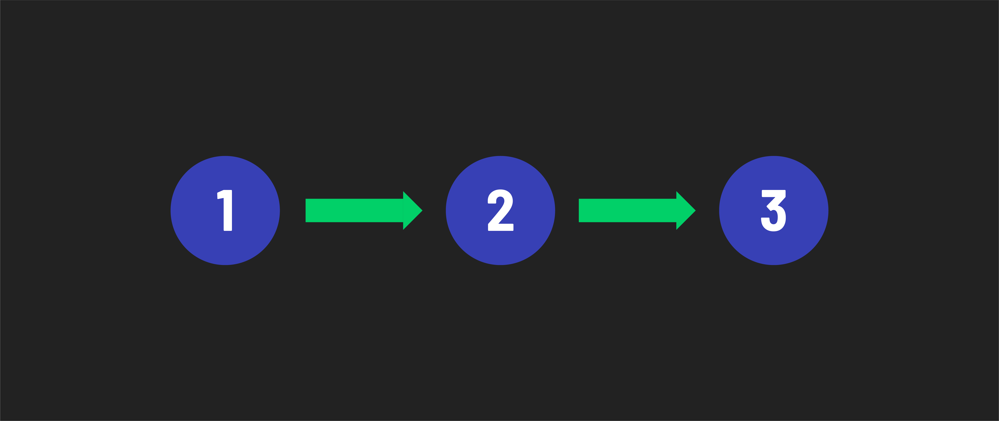
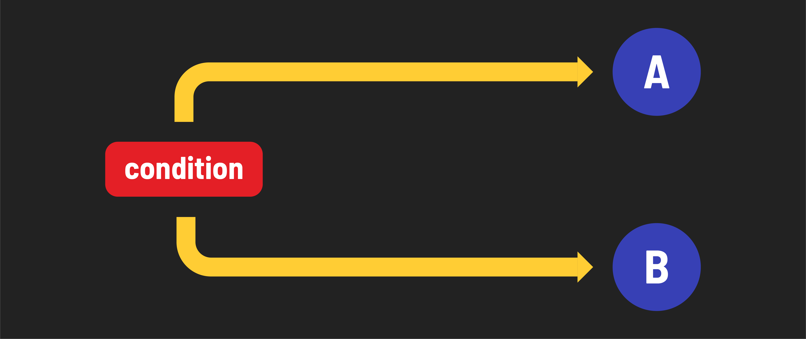
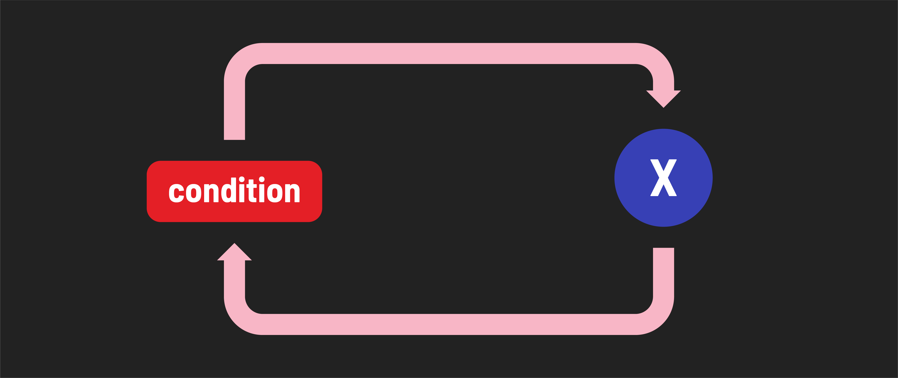

# 

**Learning objective:** By the end of this lesson, students will understand the three types of control flow and their importance in programming. 

## What is control flow? 

Control flow is the order code is executed in a program. Control flow allows us to create responsive programs that can control what code is executed based on certain conditions. Control flow is determined using control structures to create branches and loops.

### Basic types of control flow

**Sequence:** Statements execute one at a time in succession. This is the default behavior.

**Branching:** Different code paths are executed based on a conditional expression.

**Looping:** The code in the loop repeatedly executes while a condition is truthy.

## Why is control flow important? 

By default, code is executed from the top line in the file down to the last line. 

However, this doesn't make sense in most applications. In many instances, we will need to change or manipulate this order to accomplish specific tasks, such as:

- Decision-making
- Repetition 
- User interaction
- Error handling
- And more

Ultimately, we don't always want to run every single line of code. This is where control flow becomes a fundamentally important part of programming. 
