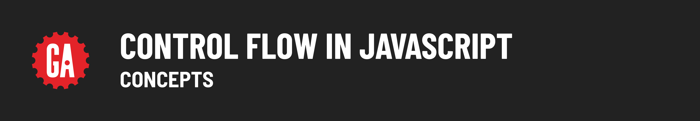

# Control Flow in JavaScript - Concepts

**Learning objective:** By the end of this lesson, students will be able to tktk

## What is control flow? 

Control flow is the execution sequence of instructions in a program determined at run time using control structures.

In other words, the control flow is the order in which statements are executed. 

## Why is control flow important? 

By default, code is executed from the top line in the file down to the last line. There are, however, many instances where we will need to change or manipulate this order to accomplish a specific task. 

## Basic types of control flow

**Sequence**: Statements execute one at a time in succession.

**Branching**: Different code paths are executed based upon a conditional expression.

**Looping**: the code in the loop repeatedly executes while a condition is truthy.