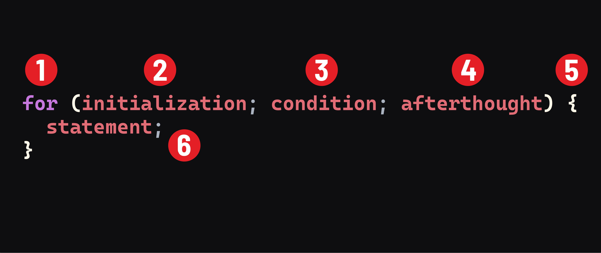

# Control Flow in JavaScript - Looping


**Learning objective:** By the end of this lesson, students will be able to compose `for` and `while` loops. 

Looping is a control flow mechanism that will repeat a set of actions until a condition is met or while a condition is truthy.

Looping statements allow us to execute a block of code multiple times, and are a fundamental part of working with collections of data like arrays. 

## for

A `for` loop repeats until a specific condition evaluates to false. `for` loops are commonly used to run a block of code a specified number of times. 

The syntax is as follows: 



1. The `for` keyword.
2. `initialization` - An expression or variable declaration evaluated once before the loop begins. Typically used to initialize a counter variable. Variables declared with let are local to the statement.
3. `condition` - An expression to be evaluated before each loop iteration. If this expression evaluates to true, statement is executed. If the expression evaluates to false, execution exits the loop.
4. `afterthought` - An expression to be evaluated at the end of each loop iteration. This occurs before the next evaluation of condition. Generally used to update or increment the counter variable.
5. A code block, if executing multiple statements.
6. Statements to be executed as long as the condition evaluates to true.

<br>

Next, let's examine the order of operation for a `for` loop, with an example:

```javascript
for (let number = 1; number < 10; number++) {
	console.log(number)
}
```

1. The `initialization` runs only once before looping begins. It is used to declare and initialize a looping variable. In this example, a new variable named `number` is initialized with the value `1`.
2. The `condition` expression is evaluated. If truthy, the code block will execute. At the start of this loop, `number` was just initialized as 1, so `number < 10` is truthy. If the value of `condition` is falsy, the `for` loop terminates.
3. The `statement` executes. 
4. The update expression `afterthought` is executed. In this example, `number` is [incremented](https://developer.mozilla.org/en-US/docs/Web/JavaScript/Reference/Operators/Increment) by 1 whenever the `afterthought` is executed. 
5. Control returns to Step 2.

<br>

## while

The `while` loop is the go to when the number of iterations is unknown.

Unlike a `for` loop, `while` loops only specify the `condition`: 

```javascript
while (/* condition */) {
  // statement block
}
```

We can refactor our previous example to a `while` loop: 

```javascript
let number = 1
while (number <= 10) {
  console.log(number)
	number++
}
```
Where, `x <= 10` is the `condition`. 

You'll notice that a `for` loop and a `while` loop work similarly, but where a `for` loop specifies all of the loop parameters up front, a `while` loop allows for more freedom in composition. This is perhaps why `while` loops are especially susceptible to causing __infinite loops__. 

For instance, it would be easy to forget to increment `number`: 
```javascript
let number = 1
while (number <= 10) {
  console.log(number)
}
```

As written, `number` will never be larger than or equal to 10, so this `while` loop will run forever, endlessly logging the number 1 until the end of time (or until we tell it to stop). 

> 🧠 An infinite loop (or endless loop) is a sequence of code that will continue endlessly. 

## You Do 🧠 

Write a `for` loop that iterates from 1 - 20 and logs out whether each number in the range is even or odd.

Sample Output: 
```bash
1 is odd 
2 is even
3 is odd
4 is even
[...]
20 is even
```

If you need a hint, check out this documentation on the [remainder operator](https://developer.mozilla.org/en-US/docs/Web/JavaScript/Reference/Operators/Remainder)

